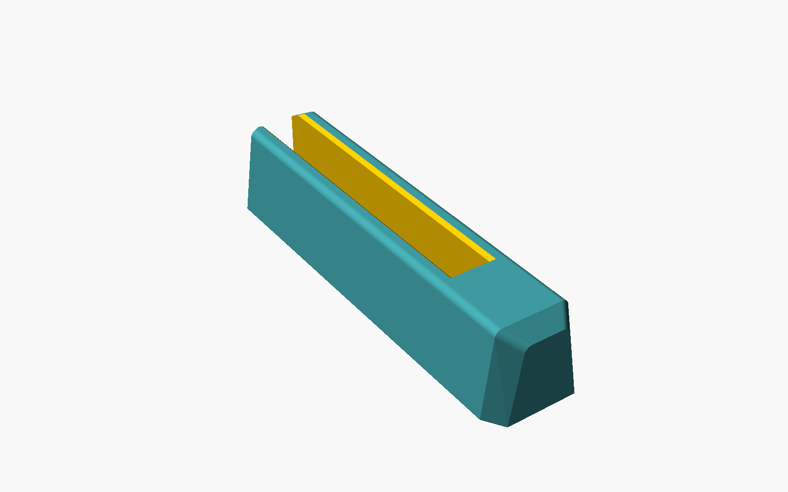

# Robot vacuum guard feet for a clothes drying rack

Replacement feet for a folding clothes drying rack. They stop a robot vacuum from getting stuck on the rack's legs.


<!-- Photo of the installed feet goes here -->

## The problem

Many folding drying racks stand on round steel tubes with a small plastic cap on each end. The tube is low enough that a robot vacuum treats it as a threshold and tries to climb over it. Partway over, the robot gets wedged and stuck.

On this rack the tube is 16 mm thick. The last 70 mm at each end is straight but angled. The tip touches the floor and the tube rises about 5 mm to the level middle section, so most of the tube sits a few millimetres off the floor.

## The solution

The foot is a 170 mm long, 35 mm tall block that replaces the plastic end cap. It's too tall for the robot to climb, so its bumper hits the block and the robot turns away like it would at a wall. The ends are sloped so the robot slides off instead of catching on a corner.

The tube end slides into a closed socket at one end of the block. The socket is tilted to match the tube's angled end section. After the socket, the block has an open channel on top that follows the tube's rise. That way the tube sits in the block without needing to match its exact shape.



## Files

| File | What it is |
| --- | --- |
| `rack_foot_guard.scad` | The parametric model (OpenSCAD) |
| `rack_foot_guard.stl` | The full 170 mm foot, ready to print |
| `rack_foot_test_60mm.stl` | A 60 mm version for testing the socket fit and angle |
| `tube_fit_test.scad` / `.stl` | Six thin rings for finding the right hole size |

The STLs are made with the default settings, which match the rack these were designed for. If your rack is different, change the settings in the `.scad` file and make new STLs.

## Fitting it to your rack

1. **Measure the tube.** Take the old caps off. Measure the tube's diameter, the length of the angled end section, and how much higher the middle of the tube is than the tip.
2. **Find the clearance.** Set `tube_d` in `tube_fit_test.scad` and print it. Each ring is labelled with its clearance, which is how much bigger the hole is than the tube. Slide the rings onto the tube and pick the one that fits snugly.
3. **Check the fit and angle.** In `rack_foot_guard.scad`, set `tube_d`, `clearance`, `end_seg_len` and `end_rise`, then print a test piece with `length = 60`. Put it on the tube and stand the rack on it. The block should sit flat on the floor. If the open end lifts, increase `end_rise`; if the closed end lifts, decrease it.
4. **Print the full feet.** You need one per leg end, usually four. The block is the same on both sides, so one file works for every corner.

### Settings

Open the `.scad` file in [OpenSCAD](https://openscad.org/) and use **Window → Customizer** to change these:

| Setting | Default | Meaning |
| --- | --- | --- |
| `tube_d` | 16.0 | Tube diameter (mm) |
| `clearance` | 0.2 | How much bigger the hole is than the tube (mm) |
| `socket_len` | 35 | How far the tube goes into the closed socket (mm) |
| `end_seg_len` | 70 | Length of the tube's straight angled end section (mm) |
| `end_rise` | 5 | How much higher the tube's middle is than its tip (mm) |
| `gap_at_tip` | 3 | Plastic under the tube tip; raises the rack by this much (mm) |
| `length` | 170 | Block length (mm) |
| `height` | 35 | Block height (mm); keep it above ~30 so the robot's bumper hits it |
| `base_w` / `top_w` | 40 / 30 | Block width at the floor and at the top (mm) |

To make the STLs from the command line:

```bash
openscad -o rack_foot_guard.stl rack_foot_guard.scad
openscad -o rack_foot_test_60mm.stl -D length=60 rack_foot_guard.scad
```

## Printing

- **Material:** PETG is recommended. It's tougher than PLA and holds its shape better under the rack's constant weight.
- **Orientation:** flat side down. No supports are needed: the socket and the test rings are teardrop-shaped so their tops print without support.
- **Walls and infill:** 3–4 walls so the channel sides can take bumps from the robot. 15–20 % infill is plenty.
- **Bed size:** the 170 mm block fits a 180 × 180 mm bed (such as a Prusa Mini). Put the long side along X and skip the brim.

Felt pads stick fine to the flat bottom if you want to protect the floor.
