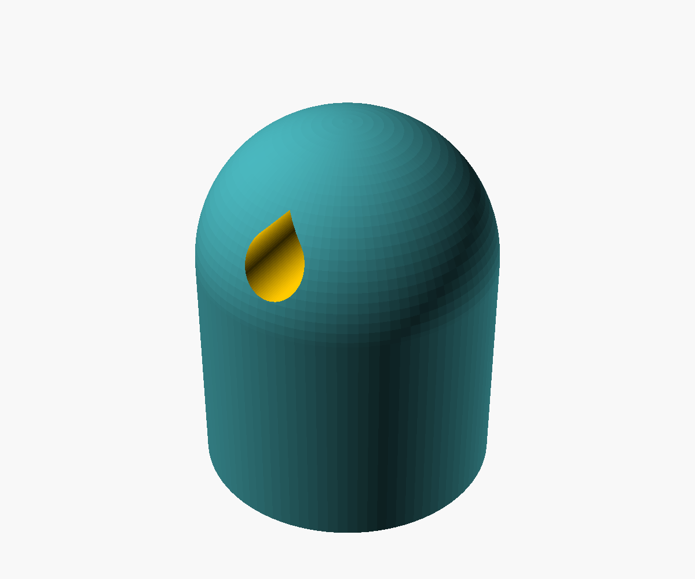
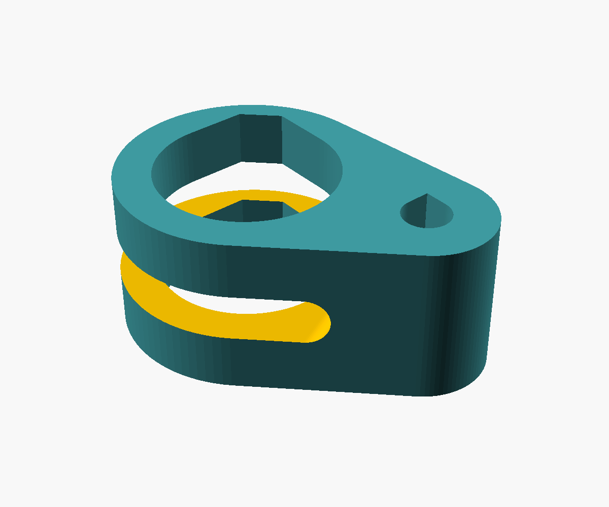

# Spare parts for the drying rack

Replacements for two plastic parts on the same Sini drying rack that tend to crack over time. Both fit the rack's 16 mm tube and its 4 mm wires.

## Rail end cap

The cap on the end of each top rail. The wire of a folding wing goes through the hole across it.

- The cap is loose on the tube so it can turn to line up with the wire.
- The wire hole is a tight fit; open it up with a 4 mm drill if the wire won't go in.
- The hole sits a little closer to the tube end than the wire does on the rack, so the tube stops about 2 mm short of the bottom and the hole can line up with the wire.

**Print** standing on the open end. No supports needed.

## Rail pivot ring

The ring that holds the rack to the far end of the stands. It turns freely on the tube.

- One wire end goes through the hole in the lobe, parallel to the tube.
- The other wire runs through the slot between the two rims. The slot is open at the back, so slide the ring onto that wire sideways before putting it on the tube; the tube then keeps the wire in place.

**Print** as the STL is oriented, lying on the flat side of the lobe. No supports needed. Printed this way, the wire pulling on the lobe pulls along the layers, not across them.

## Files

| File | What it is |
| --- | --- |
| `rail_end_cap.scad` / `.stl` | Rail end cap |
| `rail_pivot_ring.scad` / `.stl` | Rail pivot ring |

Both models are parametric: open the `.scad` file in [OpenSCAD](https://openscad.org/) and use **Window → Customizer** to change the sizes.

## Printing

PETG with 5 or more walls. The walls are thin enough that this makes both parts solid plastic, which matters more for strength than infill.
